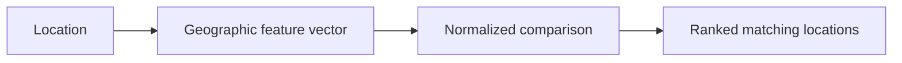

# Retail Location Similarity

Retail Location Similarity is a local geographic-embedding search tool for finding areas like a reference retail location.

Each H3 cell has a vector of nearby places, buildings, land use and access features. Supply a location, read its geographic vector and compare it with other cells. The algorithm works with compatible matrices for any region; the included verified example is London in December 2025.

[Product tour](docs/product-tour.md) · [Data and setup](docs/london-data.md) · [Use with an agent](skills/retail-location-similarity/SKILL.md) · [Project website](https://atelierneyra.com/retail-location-similarity/)



## Run locally

Python 3.11 or newer:

```sh
git clone https://github.com/latintzar/retail-location-similarity.git
cd retail-location-similarity
python location.py compare --preset covent-garden
```

This reads an original retained result immediately, using the standard library:

```text
Reference: Covent Garden
Compared cells: 131,596
Features: 1,956
Matches: 100
1. 8a195da4954ffff  84.466124
```

Shoreditch and Soho are also available. `--json` returns all 100 matches, scores and the original matrix hash:

```sh
python location.py examples
python location.py compare --preset shoreditch --json > matches.json
```

## Your location and matrix

```sh
python3 -m venv .venv
. .venv/bin/activate
pip install -r requirements.txt
python tools/fetch_london.py
python location.py embed --lat 51.5117 --lng -0.124 --json > vector.json
python location.py compare --lat 51.5117 --lng -0.124 --top 100 --json
```

The fetcher verifies the original **56,163,548-byte** matrix before installing it. For another region, connect your own H3 resolution-10 Parquet through `--matrix PATH` or `RETAIL_MATRIX_PATH`. The [data guide](docs/london-data.md) explains the schema, calculation and resource limits. The CLI uses local files and local computation; network access is an explicit data-download or optional local-map action.

## Source and data

The original London matrix contains **131,596 cells × 1,956 numeric features**, with three retained full-matrix comparisons. [Download the original data](https://github.com/latintzar/retail-location-similarity/releases/download/london-2025-12-v1/london-res10.parquet), inspect its [manifest](data/london/manifest.json) and [schema](data/london/schema.json), or read the [product and module tour](docs/product-tour.md).

Code is [MIT licensed](LICENSE); data is **ODbL 1.0** with preserved [upstream notices](data/london/NOTICES.md). The retained [global ETL source](https://github.com/latintzar/geospatial-agent/tree/main/backend/etl/global) describes the broader geographic feature-building work. Completed global output remains unverified. The exact historical London build configuration and per-record supplier ledger were not embedded; [provenance](docs/london-data.md#provenance-and-reached-stage) records that boundary.

[made by atelier neyra](https://atelierneyra.com)
